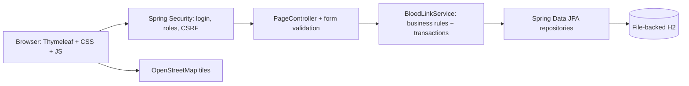
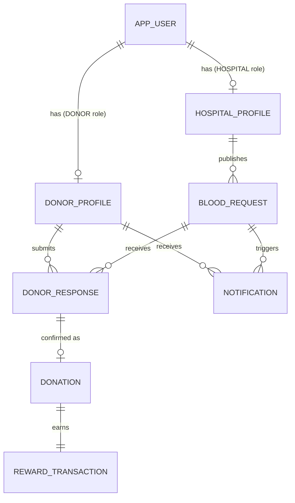
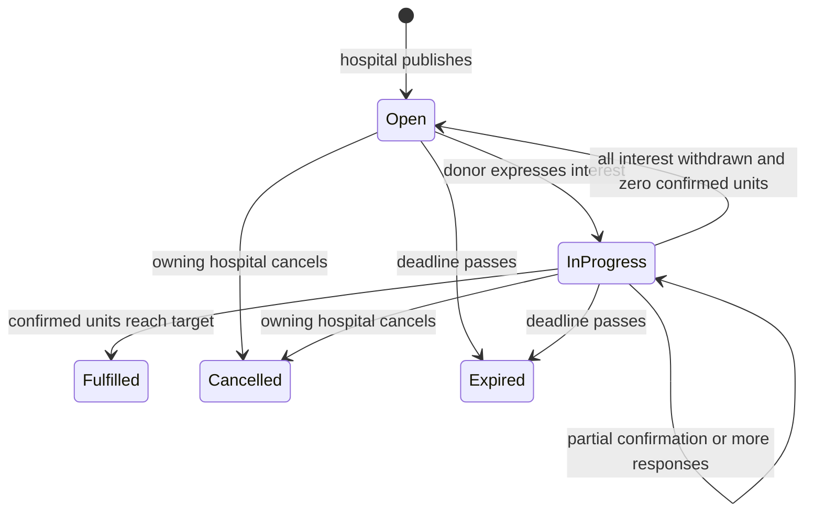

# Project guide

## Overview and architecture

BloodLink connects hospital aggregate blood needs with donors in a local classroom demonstration. The main transaction is publish → alert → respond → hospital confirmation → reward. It does not determine medical suitability or store patient records.

The browser posts ordinary forms and receives rendered pages. There is one small JSON endpoint for unread counts. `PageAdvice` supplies shared navigation data and safe errors. The service owns business decisions and transactions; the repositories supply database access. One executable Spring Boot JAR starts embedded Tomcat, so no separate application server is necessary.

## Database relationships

All eight concrete entities extend `BaseEntity`, which provides the generated primary key and optimistic version. Enum values are stored as strings for readability. JPA derives the schema; no manual SQL import is needed.

| Entity | Key information | Integrity |
|---|---|---|
| AppUser | Username, BCrypt password hash, role | Unique username; a role enum is enough for two exclusive roles |
| DonorProfile | Name, DOB, blood group, phone/email, city, optional coordinates, preference, last donation date | One profile per donor user; coordinates never rendered to other users |
| HospitalProfile | Name, address, city, phone, coordinates | One profile per hospital user |
| BloodRequest | Hospital FK, group, target, confirmed total, urgency, deadline, description, status, created time | Owner is assigned from the authenticated user, never a posted hospital ID |
| DonorResponse | Request FK, donor FK, status, response time | Unique `(request_id, donor_id)` |
| Notification | Request FK, donor FK, seen, created time | Unique `(request_id, donor_id)` |
| Donation | Response FK, units, confirmation time | Unique response FK, so a response has at most one donation |
| RewardTransaction | Donation FK, points | Unique donation FK, so an event earns only once |

Donation donor/request are reached through its response, rather than duplicating foreign keys. Notification content is rendered from its linked request. Points are summed from reward transactions, not maintained as a second balance that could drift. Badges are derived from confirmed event counts; a badge table is unnecessary.

## Request lifecycle

Open and In Progress accept interest and confirmation only before the deadline. Fulfilled, Cancelled and Expired are closed. The display status becomes Expired immediately after the deadline; a scheduled task persists expiry roughly every minute. Server actions independently check the deadline, so the scheduler interval never leaves an acceptance window.

A donor response changes Interested → Withdrawn → Interested using the same row, or Interested → Confirmed. A confirmed response cannot be withdrawn or confirmed again. Unconfirmed interest can be withdrawn even after a request closes. This removes availability without changing a closed request status.

The hospital cannot manually declare fulfillment below the target. Confirmation reaching the target changes it automatically. Existing unconfirmed responses remain visible after closure but have no confirmation action. Cancellation preserves any prior completed donations and rewards as historical records.

## Atomic confirmation and concurrency

`BloodLinkService.confirm` locks the request row, verifies the authenticated hospital owns it, checks that it accepts donations, loads the response and verifies the response belongs to the request. It requires Interested status and a positive number of units no larger than the remaining target. It then creates a donation, marks the response Confirmed, updates progress and last donation date, and creates a 100-point reward transaction.

`@Transactional` commits all of these changes together or rolls them all back. Request mutations take a pessimistic database write lock, which serializes two simultaneous confirmations for the same request. The second transaction sees the first transaction’s progress and cannot exceed the target. Database unique keys add a separate duplicate guard. Optimistic entity versions reject conflicting profile/other updates; the page asks the user to reload if another action changed a record.

The expiry task selects candidate IDs first, then locks each row and checks status again. It does not preload stale request entities that could overwrite a concurrent fulfillment.

## Notification matching and maps

At publication, donors with notifications enabled, the same blood group, and the same trimmed/case-insensitive city get one saved alert. This is demonstration matching only. It does not use blood compatibility rules, precise location, age, donation interval, or any clinical decision. Enabling preferences later does not backfill old alerts; all requests are still available in the feed.

While a donor page is visible, vanilla JavaScript requests `/api/notifications/count` about every 20 seconds, updates the unread badges, and shows a link when the count increases. The notifications page loads the full persisted list. Marking one read is a CSRF-protected POST followed by a redirect to its request. Preferences control creation of future alerts; old alerts are retained.

Leaflet displays the hospital’s saved coordinates and uses an attributed OpenStreetMap tile layer. Hospital and donor profile maps allow clicks; coordinate fields work if maps are unavailable. “Use my location” is the only code path calling browser geolocation. A denied permission produces instructions for manual entry. Donor coordinates only calculate rounded, explicitly approximate straight-line distances using the Haversine formula. They do not expose a donor marker to other users.

## OOP concepts to explain

1. **Encapsulation:** Entity fields are private. Getters/setters expose controlled access, and business operations are grouped in a service rather than scattered through pages.
2. **Abstraction:** Repository interfaces describe `findBy...` and `save` operations without exposing SQL to controllers. `PasswordEncoder` hides hashing details.
3. **Inheritance:** All entities inherit IDs and versions from `BaseEntity`. `RegistrationForm` extends `DonorForm` to reuse profile fields and validation.
4. **Polymorphism:** The service depends on the `PasswordEncoder` interface; Spring injects a `BCryptPasswordEncoder` implementation. Repository interfaces receive generated runtime implementations.
5. **Composition/association:** A request belongs to a hospital, responses associate donors with requests, and rewards belong to donations. User roles use an enum instead of a complicated user inheritance hierarchy.
6. **Dependency injection:** Constructor arguments declare the service’s dependencies. Spring constructs and supplies them, which also makes integration testing straightforward.
7. **Enums and type safety:** Blood group, role, urgency and statuses have restricted values. Impossible string spellings cannot silently create extra states.
8. **Separation of concerns:** Controllers handle HTTP/forms, services handle business rules, repositories handle storage, and templates handle presentation.

## Main routes

| Method | Route | Access / behavior |
|---|---|---|
| GET / POST | `/login` | Public form / Spring Security authentication |
| GET / POST | `/register` | Public donor registration only |
| POST | `/logout` | End authenticated session, with CSRF |
| GET | `/dashboard` | Role-specific database-derived dashboard |
| GET | `/requests` | Donor feed or owning hospital list, filter parameters |
| GET | `/requests/{id}` | Donors view public request details; hospitals only their own |
| GET | `/hospital/requests/new` | Hospital create form |
| POST | `/hospital/requests` | Validate, publish, create alerts atomically |
| POST | `/hospital/requests/{id}/cancel` | Owning hospital cancels |
| POST | `/hospital/requests/{id}/confirm/{responseId}` | Owning hospital confirms units |
| POST | `/donor/requests/{id}/respond` | Donor expresses interest |
| POST | `/donor/requests/{id}/withdraw` | Donor withdraws own unconfirmed response |
| GET / POST | `/donor/profile`, `/hospital/profile` | Own profile only |
| GET | `/donor/responses`, `/donor/rewards` | Own response/reward history |
| GET | `/donor/notifications` | Own persisted alerts |
| POST | `/donor/notifications/{id}/read` | Own alert; redirects to linked request |
| POST | `/donor/notifications/read-all` | Mark own alerts read |
| GET | `/api/notifications/count` | Own unread count as JSON |

Donor contact information is included only on the owning hospital’s response page, and hidden for withdrawn responses. There is no public donor directory. Patient names and records are never requested.
